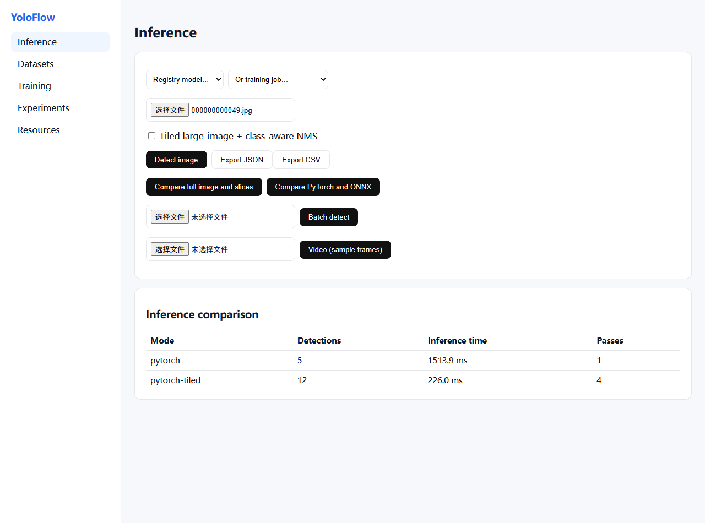
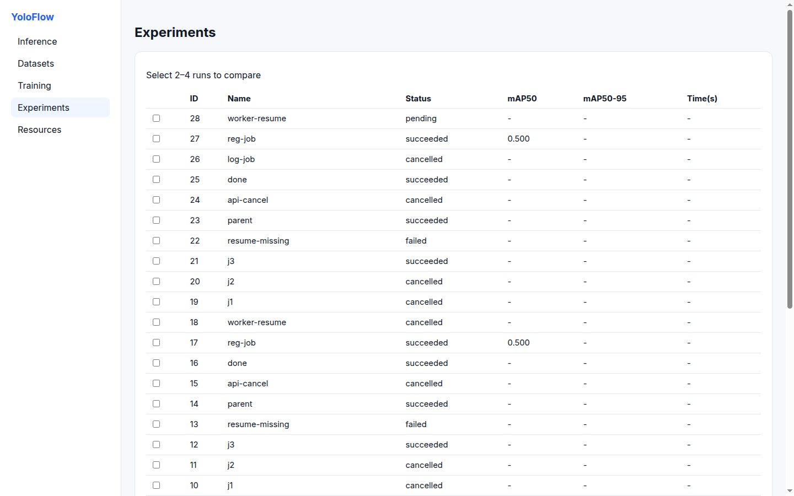
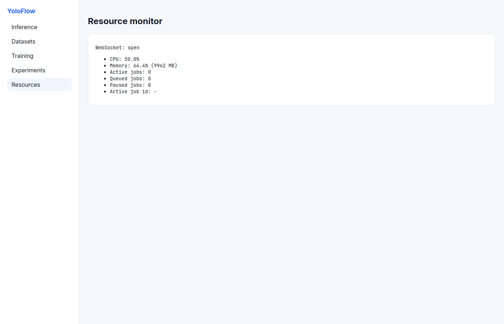

# YoloFlow

[](https://github.com/czmir/YoloFlow/actions/workflows/ci.yml)
[](LICENSE)
[](README.zh-CN.md)

**YoloFlow** is a small, self-hosted YOLO workbench for individuals and small teams: import a dataset, train on CPU (or CUDA if you have it), keep experiments and model versions, export ONNX, and run image / video / tiled-large-image inference.

It is **not** a hosted SaaS and **not** a research training framework. The product is the engineering loop around Ultralytics: validation, job control, registry, compare, and a thin UI.

Independent of [LiteTrain](https://github.com/gaoxuyang914/litetrain) source; similar problem space.

Owner-oriented architecture notes (Chinese): [docs/owner-tech-guide.zh-CN.md](docs/owner-tech-guide.zh-CN.md).

> **License honesty:** YoloFlow’s own code is **MIT**. Training and most inference call **Ultralytics**, which is **AGPL-3.0**. MIT here does **not** relicense Ultralytics. See [Licenses](#licenses) and [NOTICE.md](NOTICE.md).

## Screenshots



[PyTorch and ONNX comparison](docs/images/ui-compare-onnx.png) · [Animated walkthrough](docs/images/inference-compare-demo.gif)




<p>
  
  
</p>


## Features

- **Datasets:** YOLO YAML / folder scan / zip import, validation issues, train/val split, class histogram, bbox preview
- **Training:** SQLite-backed queue, cancel / pause / unpause, checkpoint verify, resume-from-`last.pt`
- **Workers:** in-process queue **or** standalone `worker/main.py` — compare-and-swap claim so the same job is not run twice
- **Experiments:** per-epoch metrics, compare API, confusion-matrix artifacts when Ultralytics writes them
- **Models:** version registry, SHA-256, ONNX export history, PyTorch vs ONNX IoU compare
- **Inference:** single / batch / video, class-aware tiled NMS for large images, JSON/CSV export
- **Deploy:** optional ONNX Runtime sidecar (`deploy/ort_server`, Compose profile `ort`)
- **Ops:** job log tail + SSE, resource WebSocket (heartbeat + ping/pong), CPU GitHub Actions

## Architecture

```mermaid
flowchart TB
  subgraph ui [React UI :5173]
    DS[Datasets + annotations]
    TR[Training + logs]
    EXP[Experiments]
    INF[Inference]
    RES[Resources WS]
  end
  subgraph api [FastAPI :8000]
    DB[(SQLite WAL)]
    Q[CAS training queue]
    REG[Model registry]
    INFAPI[Inference API]
  end
  subgraph worker [Standalone worker optional]
    POLL[Claim + Ultralytics]
    ATTEMPT[Isolated attempt directory]
  end
  subgraph ort [ORT service :8001]
    ORT[ONNX detect]
  end
  ui <-->|REST + WS| api
  Q -->|same claim()| POLL
  POLL --> DB
  POLL --> ATTEMPT
  REG --> DB
  ort -. optional .-> DB
```

| Path | Role |
| --- | --- |
| `backend/` | FastAPI app, SQLite, Ultralytics trainer |
| `frontend/` | Vite + React UI |
| `worker/` | Standalone poller (disable embedded queue in Compose) |
| `deploy/ort_server/` | ONNX Runtime HTTP service |
| `tests/` | pytest (no GPU required) |
| `scripts/` | setup, verify, acceptance |

## Quick start

Open **Inference**, upload an image, then select **Compare full image and slices**. Both requests use a 320-pixel model input and the same confidence threshold. Select a trained job or registered model with an ONNX export to compare backends. The [COCO128 small-object experiment](docs/small-object-benchmark.md) records per-image results and the cost of using overlapping tiles.

Pinned deps live in `backend/requirements.txt`. **Local and CI install the same versions.**

### Linux

```bash
git clone https://github.com/czmir/YoloFlow.git
cd YoloFlow
bash scripts/setup.sh
source .venv/bin/activate
export PYTHONPATH="$(pwd)/backend"

# API
uvicorn app.main:app --app-dir backend --reload --host 127.0.0.1 --port 8000

# UI (second terminal)
cd frontend && npm run dev
```

Or `bash scripts/start-dev.sh` (API + Vite). Verify:

```bash
bash scripts/verify-quickstart.sh
```

### Windows

```powershell
git clone https://github.com/czmir/YoloFlow.git
cd YoloFlow
.\scripts\setup.ps1
.\.venv\Scripts\Activate.ps1
$env:PYTHONPATH = "$PWD\backend"
.\scripts\start-dev.ps1
```

`scripts/start-dev.bat` is a cmd.exe wrapper. `setup.ps1` installs the default PyPI torch wheel (CUDA if your pip index provides it). For CPU-only, use the same CPU index as Linux:

```powershell
pip install torch==2.5.1 torchvision==0.20.1 --index-url https://download.pytorch.org/whl/cpu
```

### Docker

```bash
docker compose up --build
# API http://127.0.0.1:8000  UI http://127.0.0.1:5173
# Optional ORT sidecar:
docker compose --profile ort up ort-inference
```

Compose sets `YOLOFLOW_EMBEDDED_WORKER=false` on the API so only the `worker` service claims jobs.

## Real results (v0.2.0)

Measured **2026-11-24 21:18 Asia/Shanghai** on a Linux CPU-only VM (4× Xeon, no CUDA), `torch==2.5.1+cpu`, `ultralytics==8.3.70`. Full tables: [docs/release-acceptance-v0.2.md](docs/release-acceptance-v0.2.md) and [docs/acceptance-artifacts/infer-compare.md](docs/acceptance-artifacts/infer-compare.md).

**COCO128 + 1 epoch is still plumbing.** v0.2 primary eval uses official **COCO 2017 `train2017` vs `val2017`** (disjoint ids; 40 / 20 image subset) so the 80-class `yolov8n` head is not re-initialized. Secondary: official **VOC 2007 `train.txt` vs `val.txt`** (48 / 24).

| Step | Result |
| --- | --- |
| COCO 2017 mini train | 40 train / 20 val, 10 epochs, batch 4, imgsz 320, CPU, **25.27 s** wall |
| Val metrics (Ultralytics) | mAP50 **0.587**, mAP50-95 **0.438**, P **0.821**, R **0.428** |
| VOC 2007 mini (20-class head) | 48 / 24, 10 epochs, **26.74 s**; mAP50 **0.220**, mAP50-95 **0.180** |
| Full vs tiled on COCO val | 20 images, conf 0.25: full **44.0 ms** P **0.857** R **0.558**; tiled **114.7 ms** P **0.454** R **0.575** |
| Duplicate boxes | mean same-class IoU>0.5 pairs **9.8 pre-NMS → 0.0 post-NMS**; mean **6.75** boxes suppressed |
| Mosaic (4 distinct val images, 1140×1152) | full 6 boxes / 50.9 ms P 0.667; tiled 18 boxes / 399.9 ms, 25 tiles, 4 dups suppressed |
| Playwright E2E | upload coco8 zip, 1-epoch train **succeeded**, inspect experiments, full + tiled infer (3 boxes) |
| Docker Compose (this Linux VM) | `docker compose up --build`: `GET /health` ok, `/api/v1/datasets` 200, frontend **HTTP 200** |
| Windows `setup.ps1` | **NOT RUN** (this VM is Linux; no self-hosted Windows worker) |

Reproduce:

```bash
python scripts/prepare_public_split.py   # VOC 2007 official train/val subset
python scripts/prepare_coco_subset.py    # COCO 2017 official train/val subset
python scripts/acceptance_v02.py         # train + full vs tiled tables
python scripts/acceptance_train.py       # 1-epoch COCO128 smoke; fails if ONNX compare is skipped
bash scripts/acceptance_e2e.sh           # Playwright against live API+Vite
bash scripts/acceptance_compose.sh       # docker compose health/API
```

## API samples

```bash
# Health
curl -s http://127.0.0.1:8000/health

# Import YOLO yaml
curl -s -X POST "http://127.0.0.1:8000/api/v1/datasets/import-yaml?path=/abs/path/data.yaml&name=coco128"

# Start a job (queued; claimed by the API worker or standalone worker)
curl -s -X POST http://127.0.0.1:8000/api/v1/training/jobs \
  -H 'content-type: application/json' \
  -d '{"name":"demo","dataset_id":1,"epochs":3,"batch_size":4,"imgsz":320}'

# Pause / cancel
curl -s -X POST http://127.0.0.1:8000/api/v1/training/jobs/1/pause
curl -s -X POST http://127.0.0.1:8000/api/v1/training/jobs/1/cancel

# Detect
curl -s -X POST http://127.0.0.1:8000/api/v1/inference/detect \
  -F "file=@image.jpg" -F "job_id=1" -F "tiled=false"

# Standalone ORT
curl -s http://127.0.0.1:8001/health
curl -s -X POST http://127.0.0.1:8001/v1/detect -F "file=@image.jpg" -F "conf=0.25"
```

Resource WebSocket: `ws://127.0.0.1:8000/ws/resources` — snapshot ~1 Hz, send `ping` → `{ "type": "pong" }`.

## Known limits

- Single-node SQLite. Two processes can train two *different* jobs; CAS only prevents double-claim of the **same** row.
- Cooperative pause/cancel runs at **epoch end**, not mid-batch.
- Crash recovery re-queues `running` jobs whose heartbeat is older than `YOLOFLOW_JOB_LEASE_SECONDS` (default 90s).
- Default path is CPU and nano weights. This is not a distributed trainer.
- Zip import rejects path traversal and enforces file-count / uncompressed-size caps; `.pt` load is restricted to builtin Ultralytics names or files under `data/`.
- `COCO128` 1-epoch mAP is a smoke metric only. Cite v0.2 COCO 2017 mini / VOC 2007 mini for independent-split numbers.

## Licenses

| Piece | License |
| --- | --- |
| YoloFlow repository (this code) | MIT — [LICENSE](LICENSE) |
| Ultralytics (`ultralytics` PyPI, YOLO weights, their utils) | **AGPL-3.0** (or Ultralytics commercial license) |
| ONNX Runtime, PyTorch, FastAPI, React, … | their upstream licenses |

If you **distribute** a binary or host a network service that includes Ultralytics, AGPL-3.0 source-offer rules may apply to that combination. Publishing this MIT tree does not waive them. If that is a problem, replace Ultralytics or buy their commercial license.

## CI

GitHub Actions (`.github/workflows/ci.yml`): CPU torch `2.5.1`, pinned `backend/requirements.txt`, `pytest`, frontend `tsc` + `vite build`.
