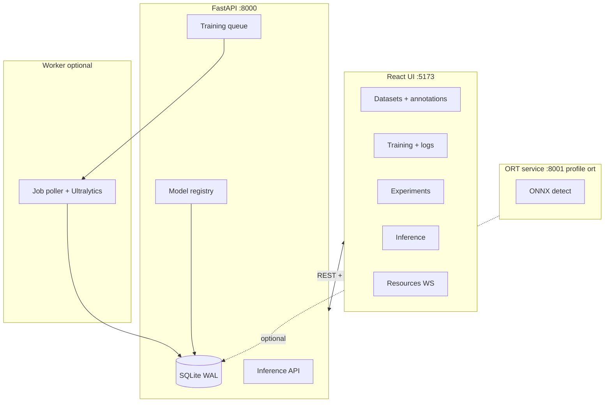

# YoloFlow

[中文说明](README.zh-CN.md)

Lightweight YOLO vision platform for individuals and small teams: datasets, CPU-friendly training, model registry, ONNX export, experiments, and production-oriented inference (batch, video, tiled large images).

Independent of [LiteTrain](https://github.com/gaoxuyang914/litetrain) code; similar problem space.

## Architecture



## Quick start

```bash
bash scripts/setup.sh
# Linux with venv:
source .venv/bin/activate
export PYTHONPATH="$(pwd)/backend"

# API
uvicorn app.main:app --app-dir backend --reload --host 127.0.0.1 --port 8000

# UI (new terminal)
cd frontend && npm run dev
```

Verify locally:

```bash
bash scripts/verify-quickstart.sh
```

Acceptance training (real COCO128, 1 epoch, CPU):

```bash
python scripts/acceptance_train.py
```

Docker:

```bash
docker compose up --build
# Optional ONNX sidecar:
docker compose --profile ort up ort-inference
```

## Key APIs

| Area | Examples |
| --- | --- |
| Datasets | `POST /api/v1/datasets/upload-zip`, `.../split`, `.../samples/.../annotations` |
| Training | `POST /api/v1/training/jobs`, `GET .../queue`, `GET .../jobs/{id}/logs` |
| Models | `GET /api/v1/models`, `POST .../compare-batch` |
| Inference | `POST /api/v1/inference/detect-batch`, `.../export-detections` |
| Experiments | `GET /api/v1/experiments`, `POST /api/v1/experiments/compare` |
| Monitor | `WS /ws/resources` (ping/pong + metrics) |

## Repository layout

| Path | Role |
| --- | --- |
| `backend/` | FastAPI app |
| `frontend/` | React + Vite |
| `worker/` | Standalone training poller |
| `deploy/ort_server/` | YF-7 ORT microservice |
| `tests/` | pytest suite |
| `scripts/` | setup, verify, acceptance |

## CI

GitHub Actions: `.github/workflows/ci.yml` — backend `pytest`, frontend `typecheck` + `build`.

## License

MIT — see [LICENSE](LICENSE).