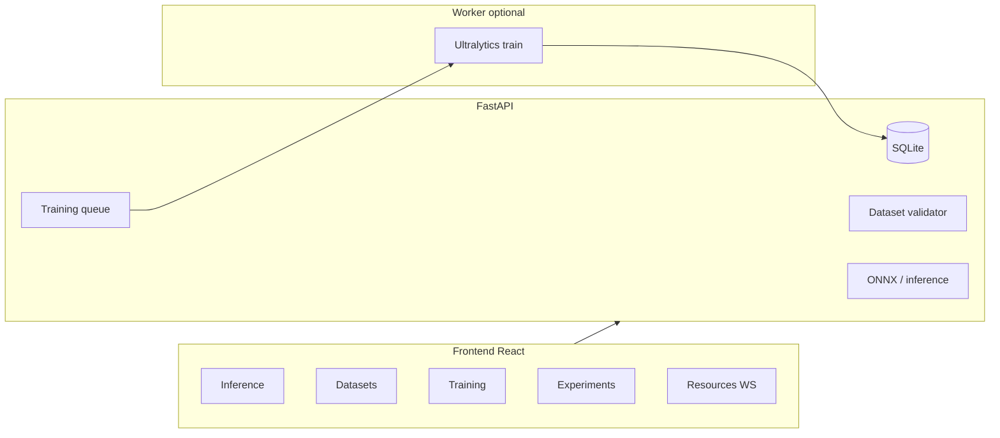

# YoloFlow

[中文说明](README.zh-CN.md)

Lightweight YOLO vision platform for individuals and small teams: dataset validation, CPU-friendly training, ONNX export, inference (including tiled large images), and a minimal experiment UI.

Inspired by the problem space of [LiteTrain](https://github.com/gaoxuyang914/litetrain); **independent implementation** (React + simplified job queue, no LiteTrain code copy).

## Architecture



## Quick start

```bash
# Linux / macOS (python3-venv recommended)
bash scripts/setup.sh
source .venv/bin/activate   # or use system pip
export PYTHONPATH="$(pwd)/backend"

# Terminal 1 — API
uvicorn app.main:app --app-dir backend --reload --host 127.0.0.1 --port 8000

# Terminal 2 — UI
cd frontend && npm run dev

# Acceptance train (COCO128, 1 epoch CPU) + ONNX compare
python scripts/acceptance_train.py
```

Docker: `docker compose up --build` (API `:8000`, frontend `:5173`, worker polls pending jobs).

## Repository layout

| Path | Role |
| --- | --- |
| `backend/` | FastAPI, SQLite models, Ultralytics training hooks, inference |
| `worker/` | Optional standalone job poller |
| `frontend/` | React + TypeScript (Vite) |
| `shared/` | Cross-language types |
| `scripts/` | Setup, dev start, acceptance training |
| `deploy/` | Dockerfiles |
| `tests/` | pytest smoke + dataset validation |

## Push to GitHub (`czmir/YoloFlow`)

```bash
git remote add yoloflow https://github.com/czmir/YoloFlow.git   # once
git push -u yoloflow main
```

If the default `origin` points elsewhere, add `yoloflow` as above or retarget `origin` to the YoloFlow URL.

## Roadmap (YF-2 … YF-8)

- **YF-2** Full dataset ZIP UX, quality gates, versioning
- **YF-3** Robust scheduler, cancel/resume, multi-worker
- **YF-4** Experiment compare, richer charts
- **YF-5** Model registry, ONNX opset matrix
- **YF-6** Production tiling policies, batch infer
- **YF-7** Standalone ONNX Runtime deployment service
- **YF-8** CI hardening, docs, release pipeline

## License

MIT — see [LICENSE](LICENSE).