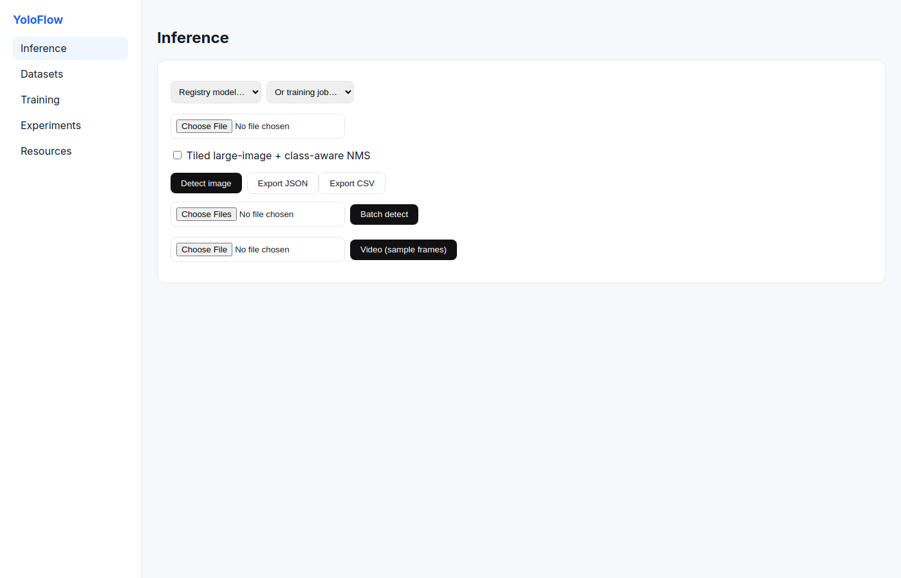
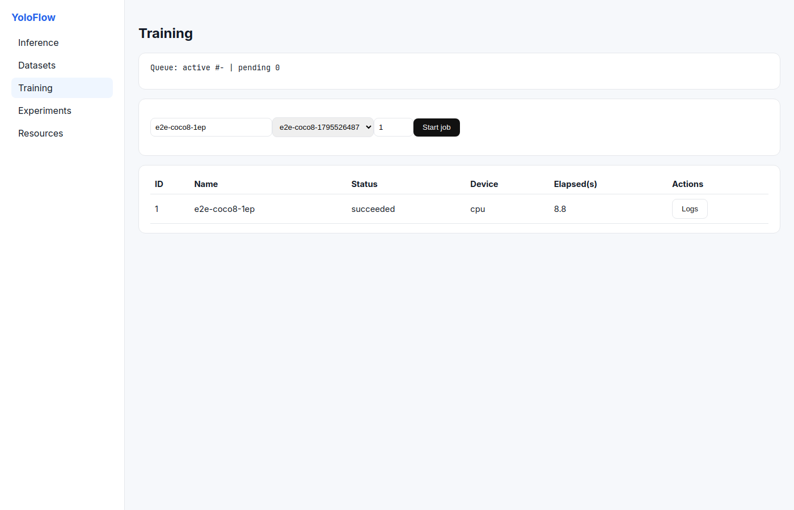
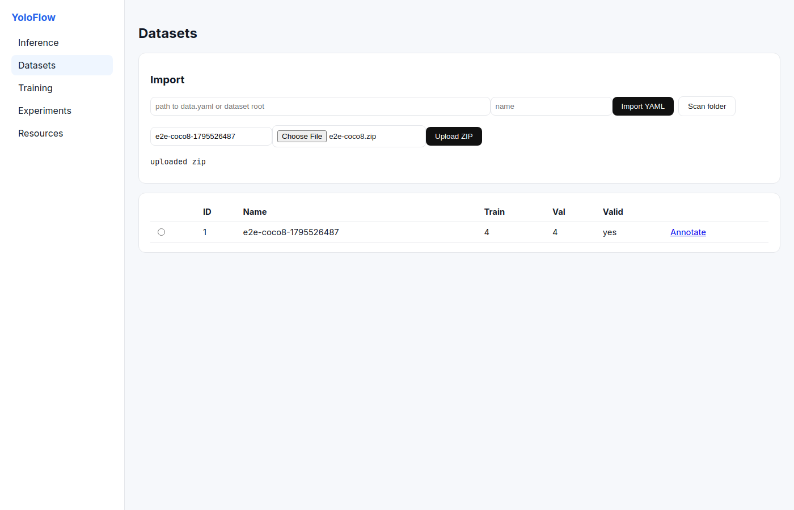
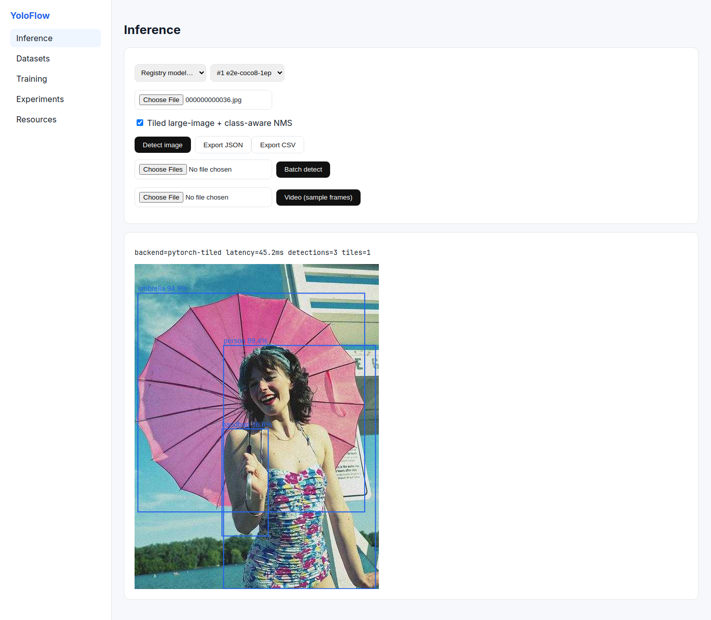

# YoloFlow

[](https://github.com/czmir/YoloFlow/actions/workflows/ci.yml)
[](LICENSE)
[](README.zh-CN.md)

**YoloFlow** is a small, self-hosted YOLO workbench for individuals and small teams: import a dataset, train on CPU (or CUDA if you have it), keep experiments and model versions, export ONNX, and run image / video / tiled-large-image inference.

It is **not** a hosted SaaS and **not** a research training framework. The product is the engineering loop around Ultralytics: validation, job control, registry, compare, and a thin UI.

Independent of [LiteTrain](https://github.com/gaoxuyang914/litetrain) source; similar problem space.

> **License honesty:** YoloFlow’s own code is **MIT**. Training and most inference call **Ultralytics**, which is **AGPL-3.0**. MIT here does **not** relicense Ultralytics. See [Licenses](#licenses) and [NOTICE.md](NOTICE.md).

## Screenshots







<p>
  
  
</p>


## Features

- **Datasets:** YOLO YAML / folder scan / zip import, validation issues, train/val split, class histogram, bbox preview
- **Training:** SQLite-backed queue, cancel / pause / unpause, checkpoint verify, resume-from-`last.pt`
- **Workers:** in-process queue **or** standalone `worker/main.py` — compare-and-swap claim so the same job is not run twice
- **Experiments:** per-epoch metrics, compare API, confusion-matrix artifacts when Ultralytics writes them
- **Models:** version registry, SHA-256, ONNX export history, PyTorch vs ONNX IoU compare
- **Inference:** single / batch / video, class-aware tiled NMS for large images, JSON/CSV export
- **Deploy:** optional ONNX Runtime sidecar (`deploy/ort_server`, Compose profile `ort`)
- **Ops:** job log tail + SSE, resource WebSocket (heartbeat + ping/pong), CPU GitHub Actions

## Architecture

```mermaid
flowchart TB
  subgraph ui [React UI :5173]
    DS[Datasets + annotations]
    TR[Training + logs]
    EXP[Experiments]
    INF[Inference]
    RES[Resources WS]
  end
  subgraph api [FastAPI :8000]
    DB[(SQLite WAL)]
    Q[CAS training queue]
    REG[Model registry]
    INFAPI[Inference API]
  end
  subgraph worker [Standalone worker optional]
    POLL[Claim + Ultralytics]
  end
  subgraph ort [ORT service :8001]
    ORT[ONNX detect]
  end
  ui <-->|REST + WS| api
  Q -->|same claim()| POLL
  POLL --> DB
  REG --> DB
  ort -. optional .-> DB
```

| Path | Role |
| --- | --- |
| `backend/` | FastAPI app, SQLite, Ultralytics trainer |
| `frontend/` | Vite + React UI |
| `worker/` | Standalone poller (disable embedded queue in Compose) |
| `deploy/ort_server/` | ONNX Runtime HTTP service |
| `tests/` | pytest (no GPU required) |
| `scripts/` | setup, verify, acceptance |

## Quick start

Pinned deps live in `backend/requirements.txt`. **Local and CI install the same versions.**

### Linux

```bash
git clone https://github.com/czmir/YoloFlow.git
cd YoloFlow
bash scripts/setup.sh
source .venv/bin/activate
export PYTHONPATH="$(pwd)/backend"

# API
uvicorn app.main:app --app-dir backend --reload --host 127.0.0.1 --port 8000

# UI (second terminal)
cd frontend && npm run dev
```

Or `bash scripts/start-dev.sh` (API + Vite). Verify:

```bash
bash scripts/verify-quickstart.sh
```

### Windows

```powershell
git clone https://github.com/czmir/YoloFlow.git
cd YoloFlow
.\scripts\setup.ps1
.\.venv\Scripts\Activate.ps1
$env:PYTHONPATH = "$PWD\backend"
.\scripts\start-dev.ps1
```

`scripts/start-dev.bat` is a cmd.exe wrapper. `setup.ps1` installs the default PyPI torch wheel (CUDA if your pip index provides it). For CPU-only, use the same CPU index as Linux:

```powershell
pip install torch==2.5.1 torchvision==0.20.1 --index-url https://download.pytorch.org/whl/cpu
```

### Docker

```bash
docker compose up --build
# API http://127.0.0.1:8000  UI http://127.0.0.1:5173
# Optional ORT sidecar:
docker compose --profile ort up ort-inference
```

Compose sets `YOLOFLOW_EMBEDDED_WORKER=false` on the API so only the `worker` service claims jobs.

## Real results (smoke, not a paper)

Measured on a **Linux CPU-only** cloud VM (see `docs` / store report after a full run). **COCO128 + 1 epoch is plumbing**, not a generalization claim.

Measured **2026-11-24 14:43 Asia/Shanghai** on this Linux CPU VM (4× Xeon, no CUDA), `torch==2.5.1+cpu`, `ultralytics==8.3.70`. Full tables: [docs/release-acceptance.md](docs/release-acceptance.md).

| Step | Result |
| --- | --- |
| Import + validate | COCO128, 128/128 images, 929 train labels, valid with missing-label warnings |
| Train 1 epoch | **16.51 s** wall; mAP50 **0.505**, mAP50-95 **0.379**, P **0.624**, R **0.468** |
| PT vs ONNX | image `000000000009.jpg`; PT 3 dets / 50.3 ms; ONNX 4 dets / 43.6 ms; mean IoU **0.993** |
| Large image | 1920×1440 stitch; full-frame imgsz=320 → 0 boxes; tiled 48 tiles → 104 boxes / 739 ms |
| Pause + resume | 2-epoch job paused at epoch boundary in **5.75 s**, resumed to `succeeded` in **18.79 s** |
| Crash recovery | stale `running` lease re-queued |
| Batch / video / export | 3 images; 4 video frames / 88 ms; JSON export 599 B |
| ORT service | `POST /v1/detect` HTTP 200, 4 detections, imgsz 320 |

Reproduce:

```bash
python scripts/acceptance_train.py      # 1-epoch smoke; fails if ONNX compare is skipped
python scripts/acceptance_release.py    # train, pause/resume, tiled, ORT, export
```

## API samples

```bash
# Health
curl -s http://127.0.0.1:8000/health

# Import YOLO yaml
curl -s -X POST "http://127.0.0.1:8000/api/v1/datasets/import-yaml?path=/abs/path/data.yaml&name=coco128"

# Start a job (queued; claimed by the API worker or standalone worker)
curl -s -X POST http://127.0.0.1:8000/api/v1/training/jobs \
  -H 'content-type: application/json' \
  -d '{"name":"demo","dataset_id":1,"epochs":3,"batch_size":4,"imgsz":320}'

# Pause / cancel
curl -s -X POST http://127.0.0.1:8000/api/v1/training/jobs/1/pause
curl -s -X POST http://127.0.0.1:8000/api/v1/training/jobs/1/cancel

# Detect
curl -s -X POST http://127.0.0.1:8000/api/v1/inference/detect \
  -F "file=@image.jpg" -F "job_id=1" -F "tiled=false"

# Standalone ORT
curl -s http://127.0.0.1:8001/health
curl -s -X POST http://127.0.0.1:8001/v1/detect -F "file=@image.jpg" -F "conf=0.25"
```

Resource WebSocket: `ws://127.0.0.1:8000/ws/resources` — snapshot ~1 Hz, send `ping` → `{ "type": "pong" }`.

## Known limits

- Single-node SQLite. Two processes can train two *different* jobs; CAS only prevents double-claim of the **same** row.
- Cooperative pause/cancel runs at **epoch end**, not mid-batch.
- Crash recovery re-queues `running` jobs whose heartbeat is older than `YOLOFLOW_JOB_LEASE_SECONDS` (default 90s).
- Default path is CPU and nano weights. This is not a distributed trainer.
- Zip import rejects path traversal and enforces file-count / uncompressed-size caps; `.pt` load is restricted to builtin Ultralytics names or files under `data/`.
- `COCO128` 1-epoch mAP is a smoke metric only.

## Licenses

| Piece | License |
| --- | --- |
| YoloFlow repository (this code) | MIT — [LICENSE](LICENSE) |
| Ultralytics (`ultralytics` PyPI, YOLO weights, their utils) | **AGPL-3.0** (or Ultralytics commercial license) |
| ONNX Runtime, PyTorch, FastAPI, React, … | their upstream licenses |

If you **distribute** a binary or host a network service that includes Ultralytics, AGPL-3.0 source-offer rules may apply to that combination. Publishing this MIT tree does not waive them. If that is a problem, replace Ultralytics or buy their commercial license.

## CI

GitHub Actions (`.github/workflows/ci.yml`): CPU torch `2.5.1`, pinned `backend/requirements.txt`, `pytest`, frontend `tsc` + `vite build`.
