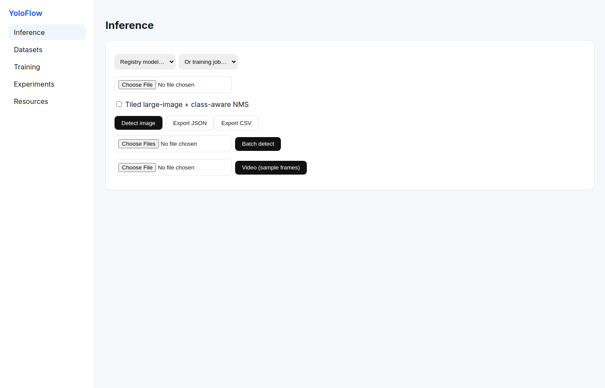
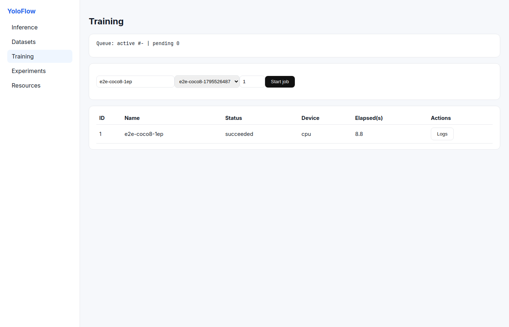
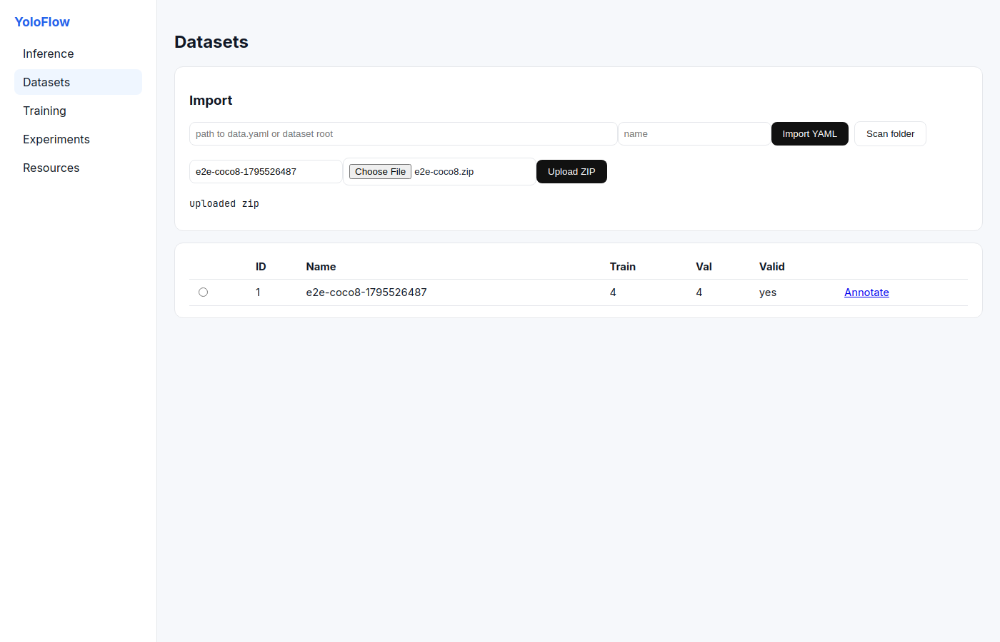

# YoloFlow

[](https://github.com/czmir/YoloFlow/actions/workflows/ci.yml)
[English](README.md)

**YoloFlow** 是给个人和小团队用的自托管 YOLO 工作台：导入数据集、在 CPU（或 CUDA）上训练、保留实验与模型版本、导出 ONNX，并做图片 / 视频 / 大图切片推理。

这不是 SaaS，也不是论文级训练框架。产品是 Ultralytics 周围的工程闭环：校验、任务控制、注册、对比、薄 UI。

独立实现，不包含 [LiteTrain](https://github.com/gaoxuyang914/litetrain) 代码。

> **许可说明（请认真看）：** 本仓库代码是 **MIT**。训练和大部分推理依赖 **Ultralytics（AGPL-3.0）**。MIT **不能**把 Ultralytics 改成 MIT。详见下方「许可证」和 [NOTICE.md](NOTICE.md)。

## 截图

首页与演示 GIF 见英文 README；图片在 [`docs/images/`](docs/images/)。







## 功能

- 数据集：YAML / 目录扫描 / zip 导入、校验问题、划分、类别分布、标注预览
- 训练：SQLite 队列、取消 / 暂停 / 继续、checkpoint 校验、从 `last.pt` 续训
- Worker：进程内队列 **或** 独立 `worker/main.py`，CAS 抢占，同一 job 不会双跑
- 实验 / 模型注册 / ONNX 对比
- 推理：单张、批量、视频、类别感知切片 NMS、JSON/CSV 导出
- 可选 ORT 侧车：`deploy/ort_server`，Compose profile `ort`
- 日志 tail / SSE，资源 WebSocket（心跳 + ping/pong）

## 快速开始

依赖版本钉死在 `backend/requirements.txt`，**本地与 CI 相同**。

### Linux

```bash
bash scripts/setup.sh
source .venv/bin/activate
export PYTHONPATH="$(pwd)/backend"
uvicorn app.main:app --app-dir backend --reload --host 127.0.0.1 --port 8000
# 另一个终端：
cd frontend && npm run dev
```

也可用 `bash scripts/start-dev.sh`。自检：`bash scripts/verify-quickstart.sh`。

### Windows

```powershell
.\scripts\setup.ps1
.\.venv\Scripts\Activate.ps1
$env:PYTHONPATH = "$PWD\backend"
.\scripts\start-dev.ps1
```

`scripts/start-dev.bat` 是 cmd 包装。CPU-only torch：

```powershell
pip install torch==2.5.1 torchvision==0.20.1 --index-url https://download.pytorch.org/whl/cpu
```

### Docker

```bash
docker compose up --build
docker compose --profile ort up ort-inference
```

Compose 里 API 设置 `YOLOFLOW_EMBEDDED_WORKER=false`，只让 `worker` 抢任务。

## 真实结果（冒烟，不是论文）

**COCO128 训练 1 个 epoch 只证明链路能跑通，不能证明泛化。** 完整数字：[docs/release-acceptance.md](docs/release-acceptance.md)。

2026-11-24 14:43（Asia/Shanghai）Linux CPU 实测摘要：1 epoch **16.51 s**，mAP50 **0.505** / mAP50-95 **0.379**；固定图 PT vs ONNX mean IoU **0.993**；2 epoch 任务真实暂停 **5.75 s** 后恢复成功 **18.79 s**；独立 ORT `POST /v1/detect` HTTP 200。

复现：

```bash
python scripts/acceptance_train.py
python scripts/acceptance_release.py
```

训练成功但跳过 ONNX 对比时，`acceptance_train.py` **不会**返回成功码。

## API 示例

```bash
curl -s http://127.0.0.1:8000/health
curl -s -X POST http://127.0.0.1:8000/api/v1/training/jobs \
  -H 'content-type: application/json' \
  -d '{"name":"demo","dataset_id":1,"epochs":3,"batch_size":4,"imgsz":320}'
curl -s -X POST http://127.0.0.1:8000/api/v1/inference/detect \
  -F "file=@image.jpg" -F "job_id=1"
curl -s -X POST http://127.0.0.1:8001/v1/detect -F "file=@image.jpg"
```

资源监控：`ws://127.0.0.1:8000/ws/resources`，发送 `ping` 收到 `pong`。

## 已知限制

- 单机 SQLite；CAS 只保证同一行不被两个 worker 同时跑
- 暂停/取消在 **epoch 结束** 生效，不是 batch 中间
- 崩溃恢复：心跳超过 `YOLOFLOW_JOB_LEASE_SECONDS`（默认 90s）的 `running` 任务会重新入队
- zip 防路径穿越；权重只允许 Ultralytics 内置名或 `data/` 下文件
- COCO128 1 epoch 的 mAP 只是冒烟指标

## 许可证

| 部分 | 许可 |
| --- | --- |
| 本仓库 YoloFlow 代码 | MIT — [LICENSE](LICENSE) |
| Ultralytics 及其权重 | **AGPL-3.0**（或 Ultralytics 商业许可） |
| ORT / PyTorch / FastAPI / React 等 | 各上游许可 |

若你**分发**包含 Ultralytics 的二进制，或用它提供网络服务，AGPL-3.0 的源码提供义务可能适用于该组合。本仓库的 MIT **不是**对 Ultralytics 的再许可。
