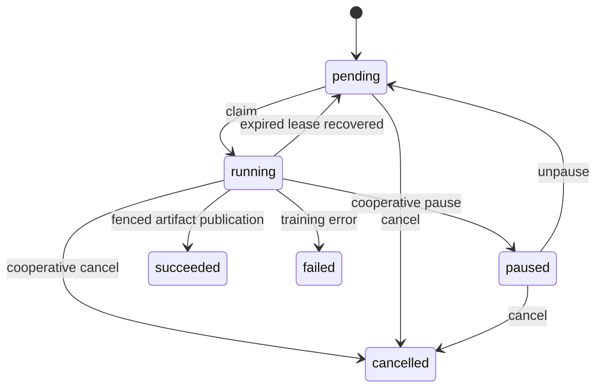

# COCO128 small-object comparison

On 2026-11-28, YOLO11n and its fixed-shape ONNX export ran on CPU using the first eight sorted COCO128 images that had a side above 320 pixels and at least one annotated bounding box below 1,024 square pixels. Each path used a 320-pixel input size and confidence of 0.25. Sliced inference used 20% overlap and class-aware suppression.

A small box counts as recalled when a prediction of the same class overlaps it at IoU greater than 0.5. IoU is the area of the boxes' intersection divided by the area of their union. Each annotation can match at most once.

| Mode | Matched small boxes | Median wall time |
| --- | ---: | ---: |
| PyTorch full image | 1 / 50 | 199.668 ms |
| PyTorch slices | 8 / 50 | 361.192 ms |
| ONNX Runtime full image | 2 / 50 | 129.707 ms |
| ONNX Runtime slices | 8 / 50 | 321.137 ms |

In this subset, cropping preserved more small-object detail and required more model passes. Objects crossing crop boundaries can lose context, while overlap increases compute and produces duplicates for suppression. Times cover one call per image and mode, including model or session construction. The small, selected sample and the use of COCO128 training images limit what this result can tell you about held-out accuracy or warmed-up throughput.

```sh
curl -fL https://github.com/ultralytics/assets/releases/download/v0.0.0/coco128.zip -o coco128.zip
curl -fL https://github.com/ultralytics/assets/releases/download/v8.3.0/yolo11n.pt -o yolo11n.pt
python -m zipfile -e coco128.zip data/datasets
python scripts/benchmark_small_objects.py data/datasets/coco128 yolo11n.pt data/small-object-coco128.json
```

[Raw results](acceptance-artifacts/small-object-coco128.json) include the selected images, checkpoint hash, software versions, and per-image observations.

[Ultralytics workflow reference](https://docs.ultralytics.com/platform/) · [SAHI sliced inference reference](https://github.com/obss/sahi)

## Training attempt isolation

A Worker lease is time-limited authority to advance a running job. Claiming uses a compare-and-swap SQL update, which succeeds only while the row is pending. Recovery also uses a conditional update and rechecks the heartbeat so a newly renewed lease survives the scan.

Each attempt gets its own working directory. The claim timestamp and Worker identity fence writes to metrics, status and the registry. A stale process can continue computing until its next callback, but it cannot publish to a newer attempt. Checkpoint resume restores training state via Ultralytics and routes new output to the fresh attempt directory. An expired attempt with no checkpoint can only restart from the original weights.



[CPU acceptance run](acceptance-artifacts/release-v0.3.json) records pause, resume from `last.pt`, ONNX export, and the ONNX Runtime service response. The report uses a repository-relative path placeholder.
